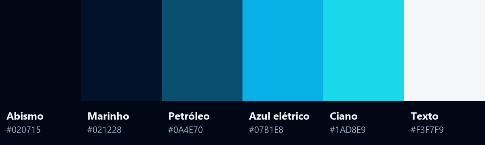

# Identidade visual @devbygusta

Padrões visuais e de conteúdo do perfil @devbygusta no Instagram: paleta, capas com personagem em 3D, carrossel "cena a cena", prompts de geração de imagem, roteiros e o processo de publicação.

## O que tem nesta pasta

| Arquivo | Conteúdo |
|---|---|
| [`prompts.md`](prompts.md) | Prompts prontos pra Magnific: capa, cena sem texto, poses e personagem original |
| [`carrosseis.md`](carrosseis.md) | Roteiros, legendas e ordem de publicação dos carrosséis |
| [`referencias.md`](referencias.md) | Referências visuais de outros perfis e as pautas na fila |
| [`figma/montar-slides-cena-a-cena.js`](figma/montar-slides-cena-a-cena.js) | Script do Figma que monta degradês, chrome, copy e chip dos slides internos |
| [`scripts/encaixar-telas.py`](scripts/encaixar-telas.py) | Cola os prints reais nas telas verdes dos mockups do post de case |
| [`scripts/capturar-pagina.mjs`](scripts/capturar-pagina.mjs) e [`costurar-pagina.py`](scripts/costurar-pagina.py) | Print da página inteira no computador e no celular, para a galeria do case e as fatias do carrossel |
| [`skills/instagram-carousel/SKILL.md`](skills/instagram-carousel/SKILL.md) | Skill do Claude Code que cria os carrosséis seguindo esse padrão |
| `assets/` | Paleta e o cenário-assinatura |

## Paleta

| Nome | Hex | Uso |
|---|---|---|
| Abismo | `#020715` | Fundo dos slides e dos degradês de leitura |
| Marinho | `#021228` | Fundo secundário |
| Petróleo | `#0A4E70` | Profundidade, sombras coloridas |
| Azul elétrico | `#07B1E8` | Glow, linha de cima da capa |
| Ciano | `#1AD8E9` | Eyebrow, palavra de destaque no título, chip |
| Texto | `#F3F7F9` | Títulos e corpo |

A paleta saiu das capas que já estavam no Figma (frame `novas capas`). Na Magnific ela existe como a Cor `devbygusta`, com as quatro do meio.

## Tipografia

- **Slides internos:** Figtree. Eyebrow ExtraBold 26 em caixa alta (letterSpacing 8%), título Black 96 (lineHeight 96%, letterSpacing -2%), corpo Regular 38 a 80% de opacidade (lineHeight 140%).
- **Capas:** título branco condensado gigante, gerado dentro da imagem.
- Uma palavra de destaque por título, sempre em ciano.

## A capa

A capa sai pronta da Magnific, com texto dentro da imagem:

- personagem famoso renderizado como filme 3D (estilo Pixar), com expressão exagerada, ocupando o terço de baixo;
- linha pequena em caixa alta no topo, às vezes em azul elétrico;
- título branco condensado em duas linhas, com a última palavra passando atrás da cabeça do personagem;
- `ARRASTA PARA O LADO` embaixo, no centro;
- cenário em marinho e ciano, com glow e painéis holográficos discretos. O cenário pode mudar pra combinar com o personagem (terraço de Gotham, cofre, cânion).

## O carrossel "cena a cena"

O mesmo personagem da capa conduz uma história, uma cena por slide. Exemplo: o Batman investigando o "caso do site invisível", em que cada slide é uma pista. Isso prende o arrasto, porque a pessoa quer ver a próxima cena.

- As cenas são geradas sem texto, com os 45% de cima escuros e vazios.
- A copy fica no Figma, editável, por cima de um degradê escuro.
- Quando o personagem da capa não pode ser usado (bloqueado no gerador ou pessoa real), o miolo usa um personagem original. A cena 02 é gerada primeiro e serve de referência pras outras, pra manter o mesmo visual.

Anatomia de um slide interno, de baixo pra cima:

1. `Cena`: imagem 1080x1350
2. `Scrim topo`: degradê de `#020715` (94% → 70% → 0%), 1080x820
3. `Scrim base`: degradê de 0% a 85%, 1080x300, em `y: 1050`
4. `Ruído & Textura` a 35%
5. `devbygusta` no topo, índice `02 / 07` e seta `→` embaixo, e o bloco de conteúdo em `x: 72, y: 170`

## O post de case (entrega de projeto)

Formato aprovado em 12/10/2026, inspirado no portfólio do @andrey.lopess. O primeiro foi o do Astro (seção `Carrosel — Case Astro (novo formato)` no Figma), e os próximos partem dele. Os cases antigos, só com texto e print, ficam como estão.

| # | Slide | Conteúdo |
|---|---|---|
| 01 | Capa | Mockup da Magnific (notebook e celular numa pedra), "Novo Projeto" e uma linha com o tipo e o nome |
| 02 | Sobre o projeto | Ícone ou logo do cliente, até 40 palavras e 4 cards (tipo, segmento, formato, acesso) |
| 03 | Paleta e fonte | As cores, o gradiente e a fonte do cliente |
| 04 a 07 | A página | O print de página inteira cortado em sequência, com um selo de vidro (índice e uma frase curta) |
| 08 | No celular | Mockup da Magnific com dois celulares |
| 09 | Vamos criar o seu? | O CTA de sempre |

- **Cor:** o que é do perfil (fundo `#020715`, glow, destaques, brilho atrás da página) fica em azul elétrico e ciano. As cores do cliente só aparecem no que é dele: telas, slide da paleta e ícone. Assim o case não destoa no grid.
- **A página:** entra com 920 de largura, em `x: 80`. O primeiro corte começa em `y: 270`, debaixo do título; os do meio ocupam o slide inteiro; o último termina com os cantos de baixo arredondados e "No ar em {endereço}".
- **Página longa:** se a página escalada passar muito de 4 fatias (a da Clínica Brenna Damasceno tem 14 mil px), os slides 04 a 06 seguem contínuos do topo e o 07 mostra a seção mais forte. Corte sempre no limite de uma seção, e de preferência entre duas seções da mesma cor, para a emenda não aparecer.
- **Sistema e loja virtual:** não têm uma página só pra fatiar, então os slides 04 a 07 mostram uma tela cada, com o cartão sangrando pela direita e por baixo (Qualifix, Gama 3D). Tela com o conteúdo do lado direito (cartão de compra, gaveta do carrinho) é recortada pra caber antes da borda do slide, senão o preço e o botão saem cortados. Na loja no ar, capture com o analytics e o pixel bloqueados, pra não sujar os números do cliente.
- **Telas dos mockups:** sempre com o print real. A IA inventa o texto miúdo das telas (no mockup da Jamilly, inventou um número de CRP). Peça a cena já com as telas em verde chapado (dá certo de primeira quando não vai print como referência) e rode `scripts/encaixar-telas.py` com `--manter-por-cima`, que deixa o notch e as pétalas por cima do print. Os prompts estão em [`prompts.md`](prompts.md).
- **Rótulo de IA:** ligado, porque a capa é um render realista feito com IA.

## Assets na Magnific

| Item | Tipo | Referência |
|---|---|---|
| `#devbygusta` | Estilo | id `2357594` |
| `@cenario-devbygusta` | Localização | id `2357575` (imagem em [`assets/cenario-devbygusta.jpg`](assets/cenario-devbygusta.jpg)) |
| `devbygusta` | Cor | paleta com 4 cores |
| `Identidade devbygusta` | Projeto | capas originais, cenas e testes |

Modelo usado: Nano Banana Pro, formato 4:5, resolução 2k (sai 1856x2304).

## Figma

Arquivo `Indentidade Gustavo Bernardi`, página `Indentidade Gustavo Bernardi`. Cada carrossel fica numa seção própria, com slides de 1080x1350 lado a lado (espaçamento de 1200 no x). As versões refeitas no formato cena a cena têm o sufixo `(v2 cena a cena)` e ficam ao lado das originais.

## Regras de conteúdo

- De 6 a 8 slides, uma ideia por slide, corpo com no máximo ~25 palavras.
- Escrever pro cliente, não sobre o processo interno.
- Não prometer resultado que depende de terceiros (posição no Google, vendas, tráfego).
- Legenda em dois blocos (a dor e a ponte pra solução) mais 5 hashtags, sem pedir comentário.
- Sem travessão na copy.
- Alternar formatos: problema, educativo, processo, checklist, case.
- Evitar repetir tema ou personagem dos últimos 3 ou 4 posts.

## Personagens e direito autoral

As capas usam personagens famosos pra prender atenção. É uma decisão consciente, sabendo que existe risco por ser uma conta comercial.

- O gerador bloqueia alguns personagens: Simpsons, Homem de Ferro, Ciclope e Toy Story (Woody e Buzz) caíram. Garfield, Bob Esponja, Batman, Scooby-Doo, Papa-Léguas, Mario, Flash (Zootopia), Tio Patinhas, Pinóquio, Patolino, Fred Flintstone e Homem-Aranha (em LEGO) passaram. Personagem novo: testar com uma imagem antes de gerar o carrossel inteiro.
- Você mesmo pode entrar como personagem (é sua imagem, com sua autorização): a foto vai como referência de imagem. Já funcionou como minifigura de LEGO.
- Pessoa real não entra nas cenas internas. Nos carrosséis com capa de pessoa real, o miolo usa personagem original.
- Capa com imagem realista feita com IA vai com o rótulo de IA ligado no Instagram.
